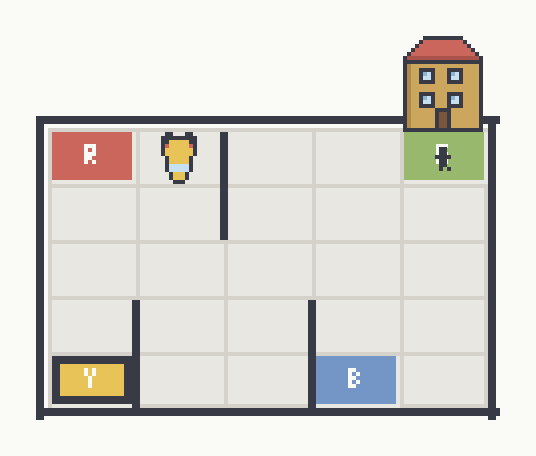

# Q-Learning on Taxi-v4

A tabular Q-learning agent for Gymnasium's Taxi-v4.



- Video: [results/videos/taxi_trained_agent.mp4](results/videos/taxi_trained_agent.mp4)
- Report: [report/report.pdf](report/report.pdf)

## Setup

```bash
git clone https://github.com/nimnay/OpenAIGym.git
cd OpenAIGym
python -m venv .venv
.venv\Scripts\python -m pip install -r requirements.txt     # macOS/Linux: .venv/bin/python
```

## Run

```bash
python main.py all
```

Or run one part at a time:

| Command | Part |
|---|---|
| `python main.py baseline` | C: baseline |
| `python main.py sweeps` | D, E, F: α, γ, ε-decay |
| `python main.py select` | G: best agent |
| `python main.py noise` | H: action noise |
| `python main.py video` | video |

Results (plots, tables, saved model, videos) go to `results/`.

## Code

- `taxi_rl/agent.py`: Q-learning agent and training loop
- `taxi_rl/metrics.py`: evaluation and learning-curve metrics
- `taxi_rl/noise.py`: action-noise wrapper
- `taxi_rl/experiments.py`: one function per assignment part
- `main.py`: command-line entry point
